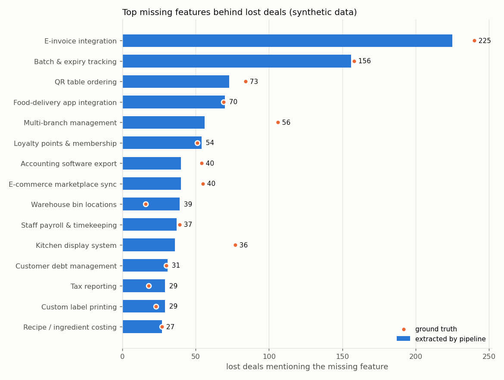
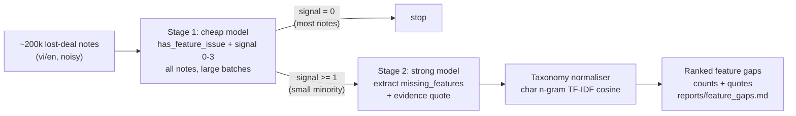
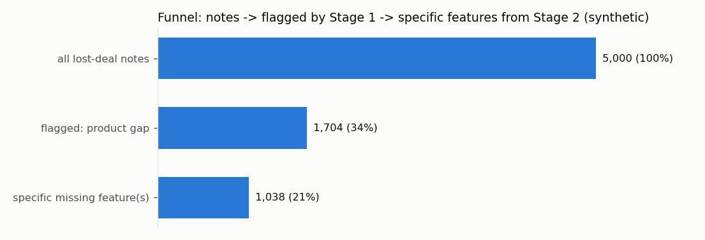

# LLM lost-deal feedback mining

Which **missing product features** are costing us deals? A two-stage LLM pipeline that reads free-text
"lost deal reason" notes from a sales CRM (Vietnamese and English mixed, often without diacritics,
full of typos) and turns them into a ranked, quotable list of feature gaps for the product team.

> Everything in this repository runs on **synthetic data** and, by default, an **offline mock LLM**.
> No API keys are needed to run it, and none of the numbers describe a real company.



## Problem

A CRM collects a short free-text reason every time a deal is lost. At ~200k notes, nobody reads them.
Product wants to know which missing features lose deals, ranked, with example quotes. The notes are hard to work with:

- mixed Vietnamese and English (`"kh yeu cau hoa don dien tu, sp chua co"`, `"Need QR ordering, we don't support it"`)
- missing diacritics, typos, abbreviations (`kh`, `ko`, `sp`)
- most notes are *not* about features (price, competitor, no answer, timing)
- the same feature is described in many ways, so free-text answers have to be mapped onto a fixed taxonomy
- some notes mention a feature *positively* ("liked the loyalty module but price too high"), which fools keyword rules

## Two-stage design



| Component | Where | Notes |
|---|---|---|
| Synthetic notes + ground truth | `feedbackmining/synthetic.py` | ~5k notes from vi/en templates, 26 features with paraphrases, typos, no-diacritic variants, hard negatives |
| Schemas | `feedbackmining/schemas.py` | Pydantic models for both stages; Stage 1 enforces `has_feature_issue == (signal >= 1)` |
| Provider-agnostic client | `feedbackmining/llm/` | Anthropic / OpenAI / Gemini / DeepSeek chosen by `LLM_PROVIDER`; SDKs imported lazily; uses `instructor` when installed |
| Offline default | `feedbackmining/llm/mock.py` | Deterministic `MockLLM` (keyword + regex heuristic) that speaks the same JSON protocol, so the whole pipeline runs without keys |
| Batching / retry / resume | `feedbackmining/pipeline.py` | Token-aware batches, exponential backoff with jitter, JSONL checkpoint per note; reruns skip finished IDs; dropped IDs trigger a retry |
| Cost tracking | `feedbackmining/cost.py`, `config/prices.json` | Tokens x price table (**illustrative prices**) |
| Taxonomy normalisation | `feedbackmining/taxonomy.py` | Accent-stripping + char n-gram TF-IDF cosine to canonical ids, with a rejection threshold |
| Stage 1 baseline | `feedbackmining/baseline.py` | TF-IDF (char + word) + LogisticRegression |
| Evaluation | `feedbackmining/evaluate.py` | P/R/F1, micro-F1, rank correlation, cost per 1k notes per provider |

## Why two stages: cost

Most lost deals have nothing to do with features. Sending every note to a strong model wastes money on
"no answer after 3 calls". The cheap model reads everything with a short output (an id, a bool and an int).
The strong model reads only the flagged minority and writes the longer extraction.

| provider | stage-1 model | stage-2 model | stage 1 | stage 2 | two-stage total | single-stage | saving |
|---|---|---|---|---|---|---|---|
| anthropic | claude-haiku-4-5 | claude-sonnet-4-5 | $0.1431 | $0.2226 | **$0.3656** | $0.4841 | 24.5% |
| openai | gpt-4o-mini | gpt-4o | $0.0181 | $0.1548 | **$0.1729** | $0.3394 | 49.1% |
| gemini | gemini-2.0-flash | gemini-2.5-pro | $0.0120 | $0.1387 | **$0.1507** | $0.2976 | 49.4% |
| deepseek | deepseek-chat | deepseek-chat | $0.0330 | $0.0170 | **$0.0499** | $0.0372 | -34.3% |

For the OpenAI and Gemini pairings, two stages cut cost by about half. When the cheap and strong model are the same (DeepSeek), two stages cost *more*, because every flagged note is read twice. The split only pays off when there is a real price gap between the models.

Prices come from `config/prices.json`. **They are illustrative and go stale quickly, so check each provider's pricing page.**
Token counts are measured on the synthetic corpus with a character-based estimate.

## Evaluation (synthetic ground truth, offline mock)

Deterministic split by hashed note id: 1,440 test notes.

**Stage 1: has_feature_issue**

| classifier | precision | recall | F1 | TP | FP | FN |
|---|---|---|---|---|---|---|
| MockLLM heuristic (zero-shot, no training data) | 0.879 | 0.962 | 0.919 | 436 | 60 | 17 |
| TF-IDF + LogisticRegression (supervised) | 0.998 | 1.000 | 0.999 | 453 | 1 | 0 |

Exact signal_strength (0-3) accuracy of the mock: 94.4%.

**Stage 2: missing_features** (normalised to the 26-feature taxonomy)

| scope | micro-precision | micro-recall | micro-F1 | TP | FP | FN |
|---|---|---|---|---|---|---|
| end-to-end (Stage 1 misses count as misses) | 0.872 | 0.735 | 0.797 | 285 | 42 | 103 |
| notes with a specific gap that Stage 1 flagged (n=336) | 0.893 | 0.752 | 0.817 | 285 | 34 | 94 |

Ranking agreement on the full corpus: Spearman rho between extracted and true feature counts = 0.73; 9/10 of the true top-10 features are in the extracted top-10. Product decisions use the *ranking*, which is more robust than per-note extraction.

Ranking agreement on the full corpus: Spearman rho between extracted and true feature counts = 0.73; 9/10 of the true top-10 features are in the extracted top-10. Product decisions use the *ranking*, which is more robust than per-note extraction.

**How to read this honestly.** The supervised TF-IDF baseline is almost perfect on Stage 1 (F1 0.999). That tells you the synthetic notes are template-generated and easy, not that the baseline would win on real CRM text. On real data the comparison should be re-run with a labelled sample, and the cheap supervised baseline is a serious candidate for Stage 1 once a few hundred labels exist. The mock heuristic stands in for a zero-shot LLM, so these numbers test the harness, not any model's quality.

Full details: [`reports/evaluation.md`](reports/evaluation.md). Output: [`reports/feature_gaps.md`](reports/feature_gaps.md).



## Run it

```bash
pip install -r requirements.txt
python -m feedbackmining.cli run          # offline MockLLM, writes reports/feature_gaps.md + charts
python -m feedbackmining.cli evaluate     # metrics + cost table, writes reports/evaluation.md
python -m pytest                          # schema, resume, taxonomy and cost tests

# with a real model (install the SDK first; checkpoints make reruns resume where they stopped)
export LLM_PROVIDER=anthropic             # or openai | gemini | deepseek
export ANTHROPIC_API_KEY=...
python -m feedbackmining.cli run --n 300
```

Checkpoints are written to `runs/<provider>-n<N>-seed<S>/stage{1,2}.jsonl`, one line per note.
Kill the run at any point and start it again: notes that are already done are skipped.

## Lessons

- **Screen cheaply, extract expensively.** Most of the cost is in reading, and most notes are irrelevant. A two-stage cascade cut the strong-model workload to the flagged minority.
- **Normalise after extraction, not in the prompt.** Ask the LLM for the customer's own words, then map them to the taxonomy deterministically. The taxonomy can then change without re-running the LLM, and every mapping can be audited.
- **The ranking is more robust than any single extraction.** Per-note errors mostly average out in the counts that product decisions rely on.
- **Make it resumable from day one.** Rate limits, timeouts and malformed JSON happen on long runs. Per-note JSONL checkpoints and ID checks make a crash cost one batch.
- **Keep a non-LLM baseline.** A TF-IDF + logistic regression screen is competitive once you have labels. The LLM's advantage is zero-shot coverage of unseen phrasings and the structured extraction.

## Original work

Original work: processed ~210k CRM notes → ~2.5k feature-gap deals → ~1.7k with specific missing features, for a few dollars of LLM cost. This repository is a clean-room rewrite on synthetic data. It contains no original code, data, prompts or taxonomy.

## License

MIT, see [LICENSE](LICENSE).
