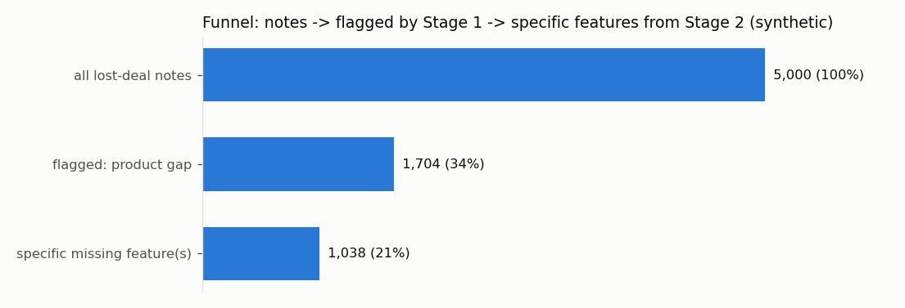
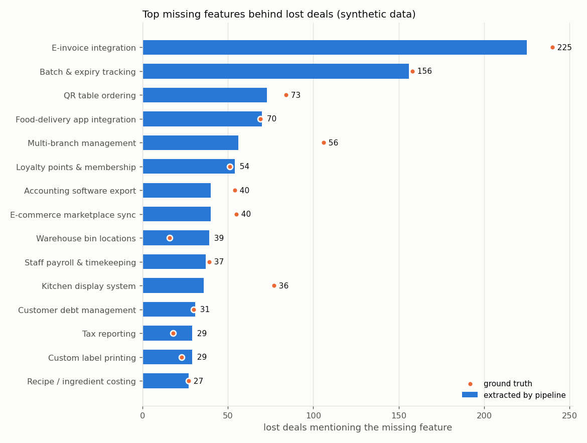

# Feature gaps behind lost deals

> **Synthetic data.** Notes are generated by `feedbackmining/synthetic.py`; counts illustrate the method only. Provider: `mock` (offline heuristic, no API calls).

## Funnel

| step | notes | share of all |
|---|---|---|
| lost-deal notes | 5,000 | 100% |
| Stage 1 flagged a product gap (signal >= 1) | 1,704 | 34.1% |
| Stage 2 found >= 1 specific missing feature | 1,038 | 20.8% |

Stage 1 signal strength distribution: 0: 3,296, 1: 312, 2: 531, 3: 861.

## Ranked missing features

Counts are deals (a note can name more than one feature). Share = share of deals with a specific feature.

| # | feature | id | deals | share | example quotes |
|---|---|---|---|---|---|
| 1 | E-invoice integration | `e_invoice` | 225 | 21.7% | "need electronic invoice and khach tu quet ma goi mon, not available" "gia cao hon ngan sach, ngoai ra khach cung hoi hddt" |
| 2 | Batch & expiry tracking | `batch_expiry` | 156 | 15.0% | "bat buoc phai co theo doi date tung lo ma minh chua lam" "Need expiry date tracking, we don't support it" |
| 3 | QR table ordering | `qr_ordering` | 73 | 7.0% | "need goi mon qua qr, we don't support it" "phi hang nam cao qua; also asked about bep xem order tren tablet which we don't have (f..." |
| 4 | Food-delivery app integration | `delivery_integration` | 70 | 6.7% | "missing food delivery integration feature ..." "thieu tinh nang don tu app giao do an do ve may tinh tien" |
| 5 | Multi-branch management | `multi_branch` | 56 | 5.4% | "too expensive for a small shop; also asked about quan ly chuoi which we don't have" "need quan ly chuoi and orders from delivery platforms flow into pos, not available" |
| 6 | Loyalty points & membership | `loyalty` | 54 | 5.2% | "need electronic invoice and khach tu quet ma goi mon, not available" "khach hoi thẻ thành viên nhung chua ho tro nen thoi" |
| 7 | Accounting software export | `accounting_export` | 40 | 3.9% | "KH: Lost because we lack daay so lieu san gke toan" "KHONG CO DAY SO LIEU SANG KE TOAN NEN KHACH KHONG MUA" |
| 8 | E-commerce marketplace sync | `marketplace_sync` | 40 | 3.9% | "price too high vs budget; also asked about sync stock with online marketplaces which we..." "Khách chê giá cao, them nua chua co e-commerce sync - da chot lost" |
| 9 | Warehouse bin locations | `bin_locations` | 39 | 3.8% | "went with competitor because they have quan ly 5 cua hang cung luc (follow up later)" "KH: khach can xuat hoa don vat tu dong va quan ly tren dien thoai day du, ben minh chua..." |
| 10 | Staff payroll & timekeeping | `payroll` | 37 | 3.6% | "price too high vs budget; also asked about timekeeping which we don't have" "missing staff attendance feature" |
| 11 | Kitchen display system | `kitchen_display` | 36 | 3.5% | "missing kitchen display feature" "khach muon giam gia 50% moimua, them nua chua co kitchen display" |
| 12 | Customer debt management | `customer_debt` | 31 | 3.0% | "Need customers pre-book a slot, we don't support it" "chon doi thu vi ho co công nợ" |
| 13 | Tax reporting | `tax_reporting` | 29 | 2.8% | "khach can bao cao thue va expiry date tracking, ben minh chua ho tro!!" "chon doi th vi ho co bao cao tuy chnih." |
| 14 | Custom label printing | `label_printing` | 29 | 2.8% | "thieu tinh nang design their own sticker labels ..." "khach can hddt va label printing, ben minh chua ho tro" |
| 15 | Recipe / ingredient costing | `recipe_bom` | 27 | 2.6% | "khach hoi cong thuc mon nhung chua ho tro nen thoi" "thieu tinh nang bom" |
| 16 | Appointment scheduling | `appointment_booking` | 27 | 2.6% | "THIEU TINH NANG LỊCH HẸN SPA" "need expiry date tracking and sync stock with online marketplaces, not available" |
| 17 | Custom reports | `custom_reports` | 25 | 2.4% | "Need custom reports, we don't support it" "need build their own reports, we don't support it" |
| 18 | Advanced promotions engine | `promotions` | 24 | 2.3% | "Lost because we lack voucher" "bat buoc phai co happy hour discounts ma minh chua lam" |
| 19 | Serial / IMEI tracking | `serial_imei` | 24 | 2.3% | "KHACH CAN XUAT HOA DON VAT TU DONG VA TRACK EXPIRATION PER BATCH, BEN MINH CHUA HO TRO" "khach hoi quan ly imei nhung chua ho tro nen thoi" |
| 20 | Full-featured mobile app | `mobile_app` | 23 | 2.2% | "KH: khach muon giam gia 50% moi mua; also asked about do everything from my phone which..." "missing som efeatures they need" |
| 21 | Open API / webhooks | `open_api` | 17 | 1.6% | "khach hoi kết nối API nhung chua ho tro nen thoi" "thieu tinh nang open API" |
| 22 | Multi-currency | `multi_currency` | 14 | 1.3% | "went with competitor because they have thu tien do va won." "need manage several outlets in one account and thanh toán ngoại tệ, not available ..." |
| 23 | Barcode scale integration | `barcode_scale` | 13 | 1.3% | "khong co can dien tu nen khach khong mua" "khach hai long voi kết nối cân, tuy nhien khách chê giá cao" |
| 24 | Offline mode | `offline_mode` | 12 | 1.2% | "Sale cmt: bat buoc phai co bán hàng offline ma minh chua lam" "Khách cần bán hàng offline mà bên mình chưa có" |
| 25 | SMS / chat marketing | `sms_marketing` | 11 | 1.1% | "missing tin nhắn quảng cáo feature" "need hoa don dien tu and gui tin nhan cham soc khach, not available" |
| 26 | Room booking | `room_booking` | 8 | 0.8% | "phi hang nam cao qua, them nua chua co đặt phòng" "phi hang nam cao qua, them nua chua co quan ly phong" |

## Run statistics

- Stage 1: 5,000 notes, 5,000 resumed from checkpoint, 0 processed in 0 batches, 0 failed.
- Stage 2: 1,704 notes, 1,704 resumed from checkpoint, 0 processed in 0 batches, 0 failed.
- Wall time: 1.3s.

_All notes were resumed from checkpoints; no calls made in this run._

Mock token counts are estimates (~3 characters per token); see `reports/evaluation.md` for projected costs per provider.
